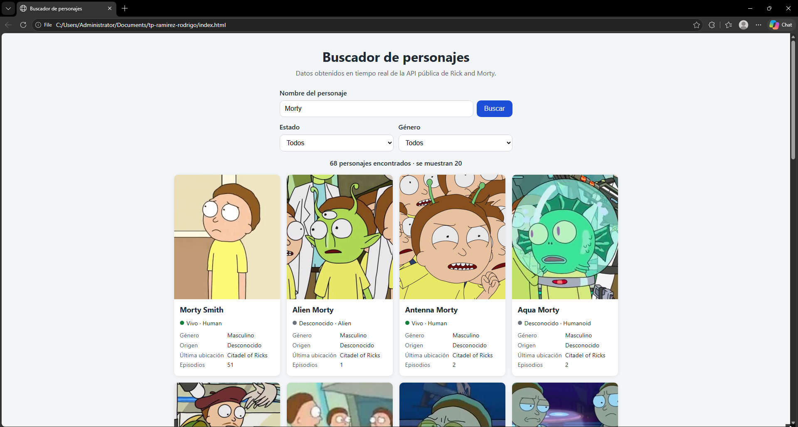

# Buscador de personajes · Rick and Morty

Aplicación web que permite buscar personajes de la serie Rick and Morty por nombre y filtrarlos por estado y género, consultando en tiempo real la API pública de la serie. Resuelve el problema de encontrar rápidamente un personaje combinando varios criterios de búsqueda.

**Autor:** Rodrigo Ramírez · Fundamentos de Desarrollo Web · UCSA
**Variante del TP:** A (filtro por género)

## Sitios publicados
- GitHub Pages: https://wesolin.github.io/tp-ramirez-rodrigo/
- Vercel / Netlify: https://tp-ramirez-rodrigo.vercel.app

## Captura


## Funcionalidades
- Búsqueda de personajes por nombre.
- Filtro por estado (vivo, muerto, desconocido).
- Filtro por género (femenino, masculino, sin género, desconocido), según la variante A.
- Los criterios se pueden combinar entre sí.
- Tarjetas con imagen, estado, especie, género, origen, última ubicación y cantidad de episodios.
- Contador de resultados encontrados y mostrados.
- Mensajes de carga, de «sin resultados» y de error de conexión.
- Número de versión visible en el pie de página.

## Tecnologías
- HTML5, CSS3, JavaScript (ES6+), Fetch API, API de Rick and Morty.

## Estructura del proyecto
```
tp-ramirez-rodrigo/
├── index.html        Página principal: formulario, filtros y contenedor de resultados
├── README.md         Documentación técnica del proyecto
├── .gitignore        Archivos excluidos del repositorio
├── css/
│   └── estilos.css   Estilos de la aplicación
├── js/
│   └── app.js        Lógica: consulta a la API, renderizado y manejo de eventos
└── img/
    └── captura.png   Captura usada en este README
```

## Cómo ejecutarlo localmente
1. `git clone https://github.com/Wesolin/tp-ramirez-rodrigo.git`
2. Abrir `index.html` en el navegador (o con Live Server).

## Despliegue
La aplicación se publica en dos plataformas: GitHub Pages y Vercel o Netlify. En ambas se publica la rama `main`, desde la raíz del repositorio y sin paso de compilación. Cada vez que se hace `git push` a `main`, las dos plataformas se actualizan automáticamente.
